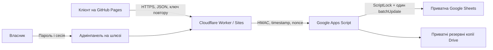

# Архітектура й модель даних

## Структура

`web/` містить сайт і адмінпанель; `shared/core.js` — чисті бізнес-правила; `shared/initial.json` — початковий каталог; `apps-script/` — сервер та ініціалізацію; `gateway/` — шлюз; `tests/` — перевірки; `scripts/` — збирання.

## Модель

Кожна вкладка має чотири технічні колонки: `id`, `version`, `data_json`, `updated_at`. JSON зберігає типізований запис; працівники редагують його через адмінпанель. Гроші — цілі копійки; момент часу — UTC ISO; робочі години — Europe/Kyiv. Зміни зимового й літнього часу враховуються при побудові слотів.

| Вкладка | Призначення |
|---|---|
| Settings | Контакти, правила запису, перерви, горизонт, стан онлайн-запису |
| Services | Послуги й архівування |
| Barbers | Майстри, фото, описи, відсотки, фіксована ставка для довідки |
| Offers | Версії ціни й тривалості для пари послуга/майстер; effectiveFrom |
| Schedules | Версії тижневого графіка; effectiveFrom |
| Exceptions | Вихідні, відпустки, особливі години, блокування часу |
| Bookings | Знімок послуги, майстра, ціни, тривалості, буфера; контакти; SHA-256 ключа; статус |
| Payments | Фактично сплачено, чайові, спосіб, знімок відсотка майстра |
| Expenses | Витрати |
| Users | Внутрішній запис власника; окремі ролі не застосовуються зі спільним паролем |
| Versions | Попередні налаштування для відновлення новою версією |
| Audit | Бізнес-аудит без телефонів і токенів; ланцюжок HMAC |
| Analytics | Тип основної дії й час без персональних даних |
| Technical | Код і тип серверної помилки без тіла запиту |
| Requests | Ключ і хеш повторного запиту, актор, відповідь |
| Notifications | Нові й змінені записи, стан прочитання |
| Periods | Закриті фінансові періоди |

Кожне бронювання має 256-бітний випадковий клієнтський ключ. У таблиці зберігається лише його SHA-256. Посилання відновлення містить ключ у fragment, який браузер не надсилає серверу під час завантаження сторінки. Сайт прибирає fragment перед подальшою роботою. Сам ключ надсилається лише HTTPS POST до шлюзу; журнали його не містять.

## Конкурентність і узгодженість

Apps Script перевіряє HMAC, timestamp і nonce. Під глобальним ScriptLock заново читає ціну, графік та зайнятість. Один Sheets `batchUpdate` атомарно записує бронювання, сповіщення, аудит і ключ повтору. Після тайм-ауту повторюйте той самий запит із тим самим ключем і тілом. Ключі повтору зберігаються 30 днів; після цього слід перевірити власний запис перед повторним створенням.

Новий прайс не переписує старі бронювання. Масовий перерахунок потребує точного попереднього розрахунку та запису про погодження клієнтами. Час і тривалість при перерахунку ціни не змінюються. Зміна графіка або архівування, що порушує активні записи, відхиляється. Відновлення налаштувань також створює нову версію.

## Авторизація

Адмінка працює за одним паролем власника, без входу через акаунт. Сервер зберігає лише остаточний криптографічний відбиток пароля. Випадковий ключ сесії передається у Secure/HttpOnly cookie; сервер перевіряє хеш, строк дії та версію пароля на кожній адміністративній операції. Зміна пароля відкликає попередні сесії.

Публічний каталог і слоти не потребують пароля. Керування клієнтським записом потребує приватного ключа. Таблиця залишається приватною, запити шлюзу підписані HMAC. CORS не замінює авторизації.

## Вибіркові читання

Каталог, слоти, власний запис і перевірка пароля завантажують лише потрібні вкладки. Операції зміни бізнес-даних зберігають повне свіже читання під ScriptLock. Кешування зайнятості не додавалося.

## Джерела рішень

- [Booksy Calendar & Scheduling](https://biz.booksy.com/features/calendar-scheduling): індивідуальні календарі й простий онлайн-запис.
- [Google ScriptLock](https://developers.google.com/apps-script/reference/lock/lock-service): серіалізація серверних операцій.
- [Google deployment versions](https://developers.google.com/apps-script/concepts/deployments): версійне розгортання.
